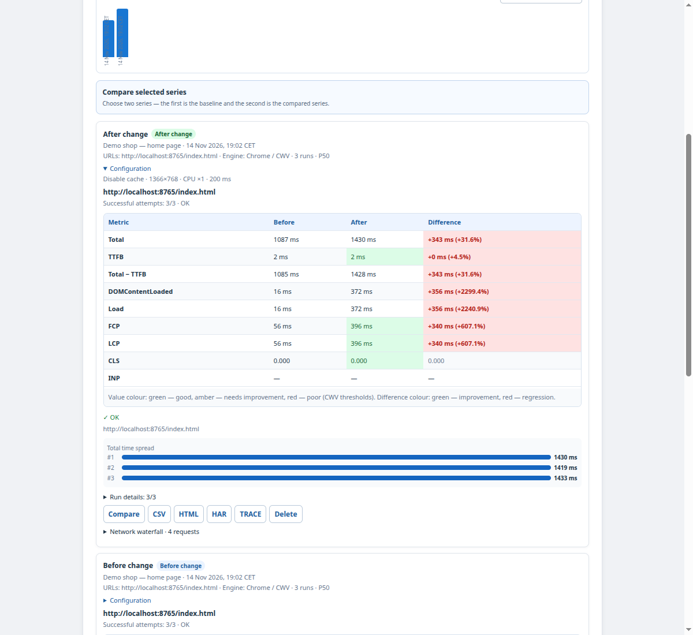
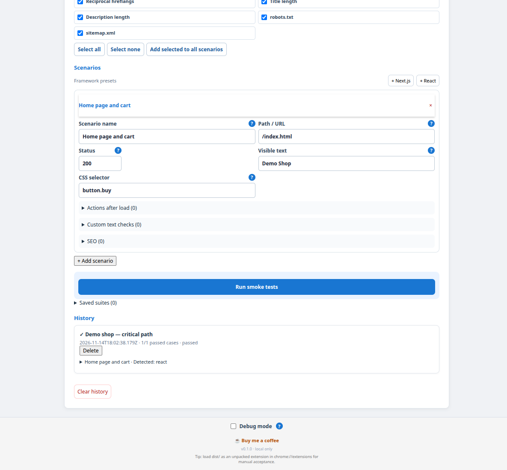
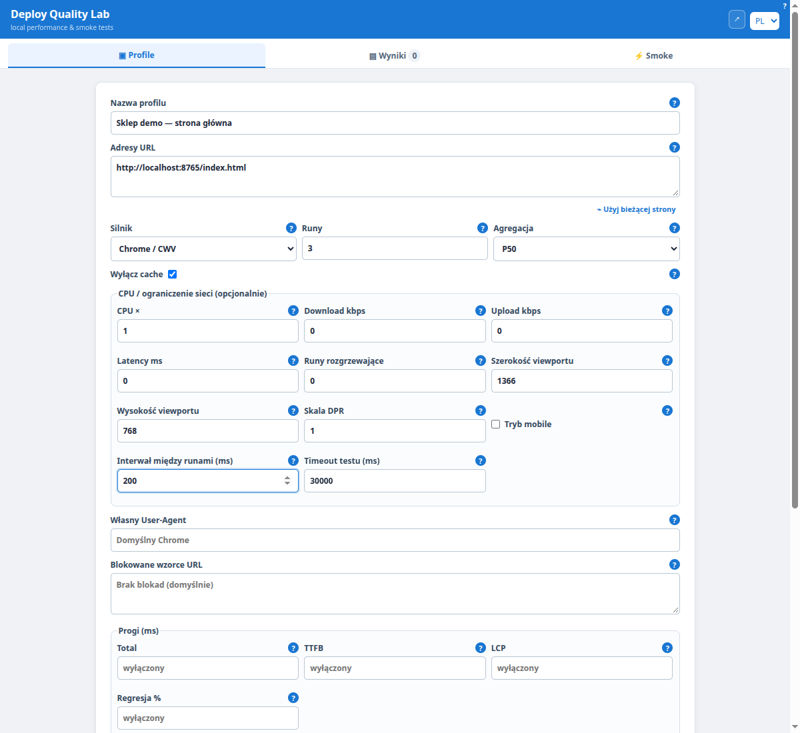
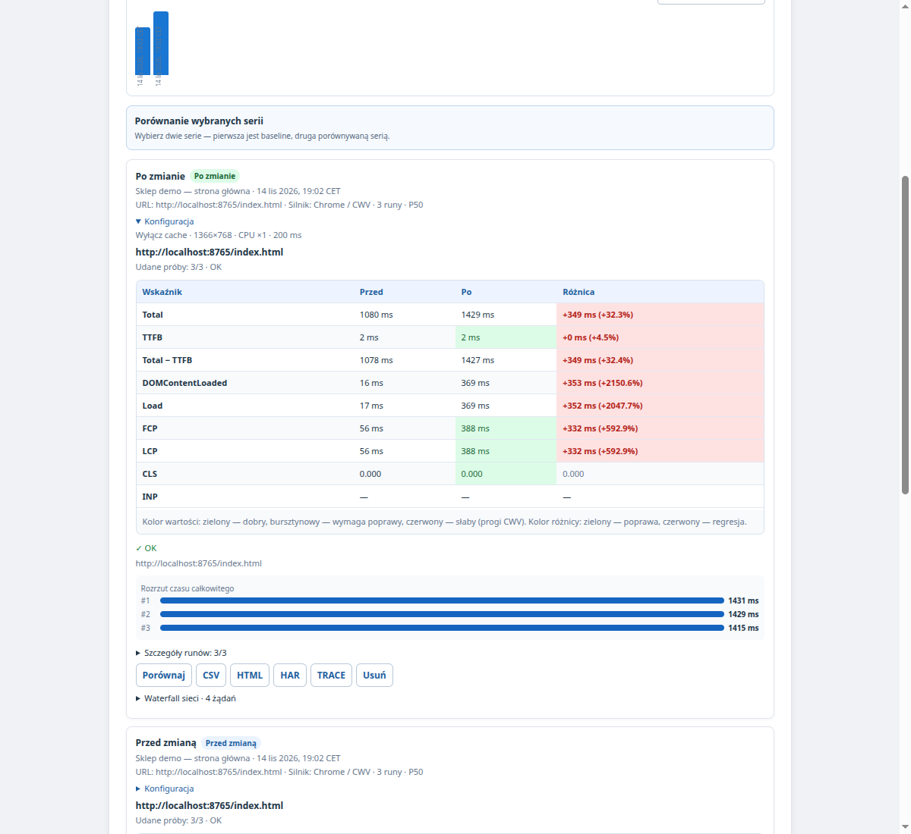
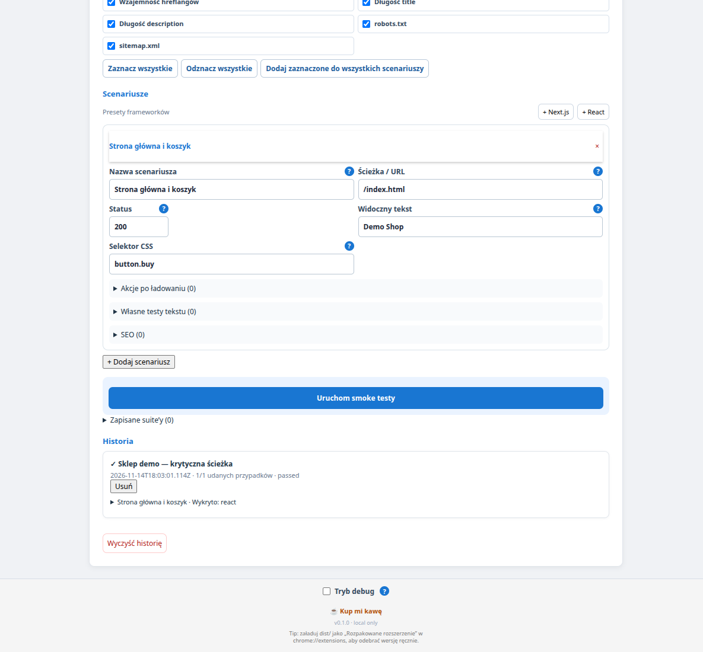

# Deploy Quality Lab

**🇬🇧 [English](#english) · 🇵🇱 [Polski](#polski)**

<p align="center"></p>

---

<a id="english"></a>

## 🇬🇧 English

**Deploy Quality Lab** is a standalone Chrome extension for comparing page performance and running smoke tests **before and after a deployment**. Everything runs locally in your browser — no SaaS, companion app, Native Messaging, local server or CLI. Measurements, HAR files and suites never leave Chrome. The full feature list and scope live in [ROADMAP.md](ROADMAP.md).

### Features

- **Performance profiles** — multiple URLs, any number of runs, warm-ups, P50 / median / P75 / P90, baseline comparison with percentage deltas and a "Total − TTFB" view.
- **Two local engines** — full Chrome page load with Core Web Vitals, or a lightweight HTTP request (fetch). Metrics: TTFB, total, DOMContentLoaded, load, FCP, LCP, CLS, INP, transfer, HTTP status.
- **Realistic conditions** — cache off, custom User-Agent, URL blocking, viewport / DPR / mobile mode, CPU and network throttling, scripted click / wait / scroll interactions.
- **Diagnostics** — HAR and DevTools trace of the median run, network waterfall, debug log.
- **Smoke tests** — saved suites with HTTP status, visible text, CSS selector, post-load actions, SEO assertions (title, description, canonical, hreflang, robots, sitemap…) and React / Next.js presets. Failures keep HAR, trace and a screenshot.
- **History and export** — filter, compare and export series to CSV, XLSX, HTML with charts and PDF; configurable retention.
- **English and Polish UI.**

### Screenshots

| Profile & measurement | Before / after comparison | Smoke suite |
| --- | --- | --- |
|  |  |  |

*Profile setup with engine, runs and throttling; a before/after comparison where a slower script shows up as a red regression; a smoke suite with a passed run in history.*

### Install

```bash
npm install
npm run build
```

Open `chrome://extensions`, enable **Developer mode**, choose **Load unpacked** and select the `dist/` folder. Click the extension icon to open the side panel.

### Quick workflow

1. Create a profile (URLs, 5+ runs, cache off) and run it as **Before change**.
2. Deploy.
3. Run the same profile as **After change**, pick the baseline and read the deltas.
4. Export HAR, trace or the history report.

### Verify

```bash
npm run typecheck
npm test
npm run build
```

### Portable package

```bash
npm run release:prepare
```

Creates `release/deploy-speed-tester-<version>/` with a ready-to-load extension for macOS, Windows and Linux.

### Limits

No login automation — never put passwords or production data in suites. Measurements come from your machine and current Chrome; this is not multi-location load testing or RUM. Lighthouse stays manual (Chrome DevTools → Lighthouse). Framework detection is best-effort.

---

<a id="polski"></a>

## 🇵🇱 Polski

**Deploy Quality Lab** to samodzielna wtyczka Chrome do porównywania wydajności stron i wykonywania smoke-testów **przed i po wdrożeniu**. Wszystko działa lokalnie w przeglądarce — bez SaaS, aplikacji towarzyszącej, Native Messaging, lokalnego serwera ani CLI. Pomiary, HAR-y i suite’y nie opuszczają Chrome. Pełną listę funkcji i zakres opisuje [ROADMAP.md](ROADMAP.md).

### Funkcje

- **Profile wydajności** — wiele URL-i, dowolna liczba runów, warm-upy, P50 / mediana / P75 / P90, porównanie z baseline, delty procentowe i widok „Total − TTFB”.
- **Dwa silniki lokalne** — pełne ładowanie w Chrome z Core Web Vitals albo lekki request HTTP (fetch). Metryki: TTFB, total, DOMContentLoaded, load, FCP, LCP, CLS, INP, transfer, status HTTP.
- **Realistyczne warunki** — cache off, własny User-Agent, blokady URL, viewport / DPR / tryb mobilny, throttling CPU i sieci, interakcje: klik, oczekiwanie, scroll.
- **Diagnostyka** — HAR i trace DevTools dla medianowego runu, waterfall sieci, log debug.
- **Smoke testy** — zapisane suite’y ze statusem HTTP, widocznym tekstem, selektorem CSS, akcjami po załadowaniu, asercjami SEO (title, description, canonical, hreflang, robots, sitemap…) i presetami React / Next.js. Przy błędzie zapisywane są HAR, trace i screenshot.
- **Historia i eksport** — filtrowanie, porównywanie i eksport serii do CSV, XLSX, HTML z wykresami i PDF; konfigurowalna retencja.
- **Interfejs po polsku i angielsku.**

### Zrzuty ekranu

| Profil i pomiar | Porównanie przed / po | Suite smoke |
| --- | --- | --- |
|  |  |  |

*Konfiguracja profilu z silnikiem, runami i throttlingiem; porównanie przed/po, w którym wolniejszy skrypt widać jako czerwoną regresję; suite smoke z zaliczonym przebiegiem w historii.*

### Instalacja

```bash
npm install
npm run build
```

W Chrome otwórz `chrome://extensions`, włącz **Developer mode**, wybierz **Load unpacked** i wskaż katalog `dist/`. Kliknięcie ikony rozszerzenia otwiera panel boczny.

### Szybki przepływ

1. Utwórz profil (URL-e, 5+ runów, cache off) i uruchom jako **Przed zmianą**.
2. Wykonaj deploy.
3. Uruchom ten sam profil jako **Po zmianie**, wskaż baseline i odczytaj delty.
4. Pobierz HAR, trace albo raport historii.

### Weryfikacja

```bash
npm run typecheck
npm test
npm run build
```

### Pakiet przenośny

```bash
npm run release:prepare
```

Polecenie tworzy `release/deploy-speed-tester-<wersja>/` z gotowym rozszerzeniem dla macOS, Windows i Linuksa.

### Ograniczenia

Brak automatyzacji logowania — nie umieszczaj w suite’ach haseł ani danych produkcyjnych. Pomiary pochodzą z Twojej maszyny i bieżącego Chrome; to nie jest test obciążeniowy z wielu lokalizacji ani RUM. Lighthouse pozostaje ręczny (Chrome DevTools → Lighthouse). Wykrywanie frameworków jest informacyjne.
